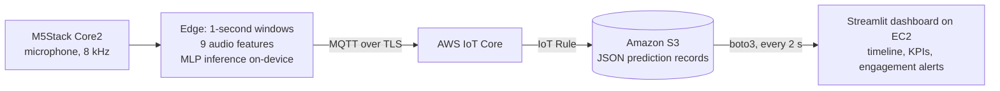
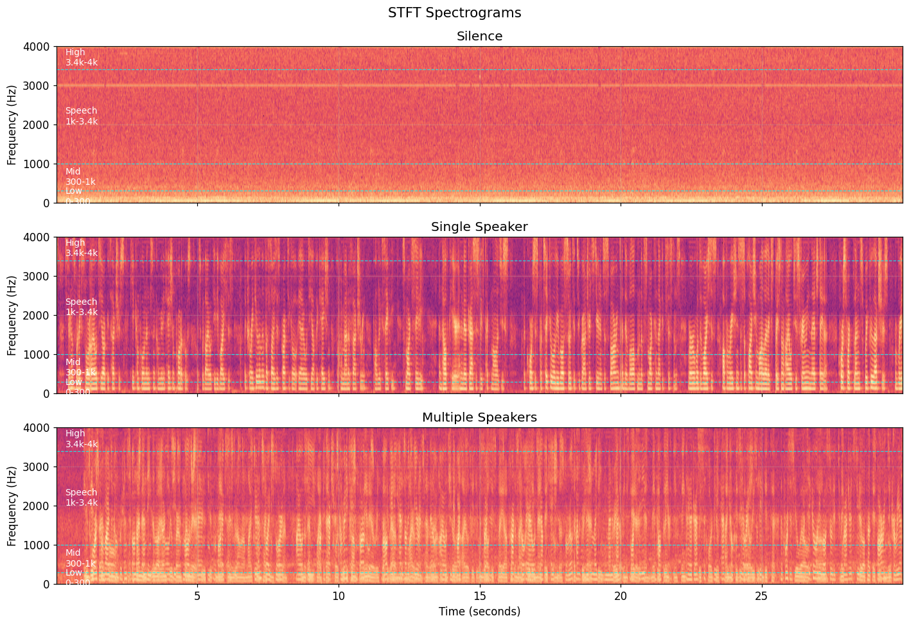
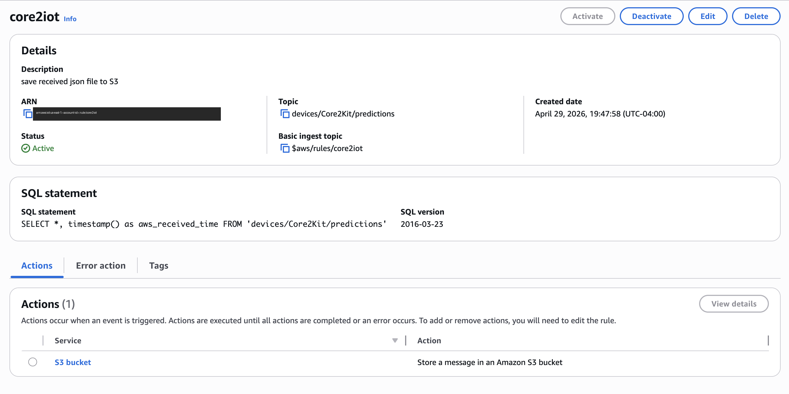
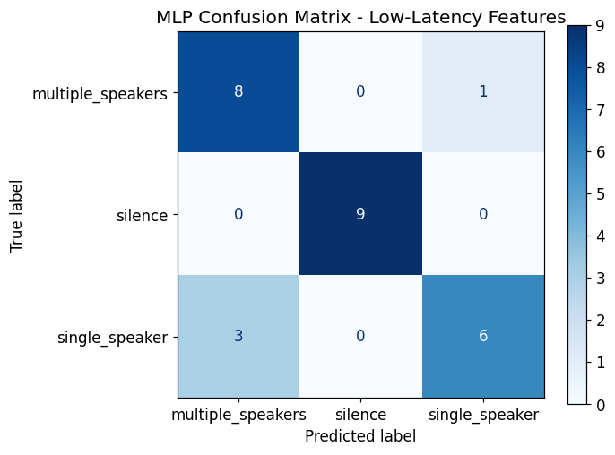

# Meeting Audio Interaction Tracker (AIoT)

**An edge-to-cloud IoT system that tracks how a meeting flows, not just how long it lasts.** An M5Stack Core2 listens through its microphone and classifies each second as **silence, one speaker, or several people talking**. It runs a small neural network on the device itself, then streams the results through **AWS IoT Core → Amazon S3** to a live **Streamlit dashboard hosted on AWS EC2**.

Columbia University APAN 5570 AIoT, Spring 2026 (Group 4).

## Why

Hybrid work means more meetings, but tools only report attendance and duration. This system measures **interaction**: how much of the meeting was silence, a single voice, or overlapping discussion, shown on a timeline.

## Architecture



**Design choice:** the device does the lightweight work (feature extraction and inference), so raw audio never leaves it. That keeps the data private and the transmission small. The cloud handles storage, aggregation and visualization.



## Dashboard (my part)

`dashboard/app.py` is a Streamlit app running on EC2. Every 2 seconds it pulls the newest prediction records from S3 with boto3, cleans them into a DataFrame and shows:

- **Live KPIs:** total windows, % single-speaker, % multi-speaker, % silence, average confidence
- **The current conversation state**, with model confidence
- **Engagement alerts:**
    - "dominated by one speaker" when single-speaker time is above 70%
    - "high silence" when silence is above 30%
    - "good interaction" when multi-speaker time is at least 30%
- **Charts (Altair):** a color-coded state timeline, the state distribution, confidence over time, and class-probability trends
- **A raw S3 record table** for debugging

Each record looks like `dashboard/sample_record.json`:

```json
{"model_version": "mlp_1sec_v1", "device_id": "Core2Kit", "timestamp": 1777506480,
 "predicted_class": "multiple_speakers", "confidence": 1,
 "probabilities": {"single_speaker": 0, "multiple_speakers": 1, "silence": 0}}
```



## Model

- **Data:** 30 seconds of recorded audio per class, cut into 90 one-second labeled windows.
- **Features (time domain, cheap enough for a microcontroller):**
    - mean absolute amplitude
    - RMS energy
    - peak
    - variance
    - zero-crossing rate
    - sub-window RMS spread and range
    - active ratio
    - longest active streak
- **Model:** a scikit-learn `MLPClassifier` with 1 hidden layer of 8 ReLU units and L2 regularization, plus standardization.
- **Edge deployment:** the trained weights and scaler are exported to `model/mlp_model_export.json`. The forward pass is re-implemented in MicroPython, with plain matrix multiplication, ReLU and softmax, in `device/edge_inference.py`.



## Results

| Metric | Result |
| --- | --- |
| Held-out test accuracy (27 windows) | **85%**: silence 100%; single vs. multi-speaker is the harder split |
| On-device vs. scikit-learn predictions | **100% match** (27/27): the MicroPython port is exact |
| Real-room accuracy (live trials) | **86% peak** (13/15), **73% average** across trials; background noise and voice volume are the main causes |
| End-to-end latency (capture → S3) | about 4 seconds |

## Limitations and next steps

- **Small, controlled training set:** collect more speakers, rooms and noise levels.
- **Latency from the S3 path:** route through **AWS Lambda + DynamoDB** for real-time state updates.
- **No processing layer between IoT Core and S3:** add aggregation for historical meeting reports.

## Repository structure

```
├── device/
│   ├── edge_inference.py     # MicroPython: features + MLP forward pass + MQTT publish (Core2)
│   └── sound_recorder.py     # MicroPython: record labeled training audio
├── model/
│   ├── train_mlp.ipynb       # waveforms, spectrograms, features, training, export, verification
│   └── mlp_model_export.json # weights + scaler for the device
├── dashboard/
│   ├── app.py                # Streamlit dashboard (EC2 + S3)
│   └── sample_record.json    # one prediction record
└── docs/
```

Credentials such as the WiFi password, AWS endpoint and device certificates are replaced with placeholders. Never commit `.pem` files.

## Team and my role

Group 4: Xikun Feng, Yang Zheng, Xiaoran Zhou, Darren Lin, Sangtian Ding.

**I built the Streamlit dashboard and data visualization** (`dashboard/`). It runs on EC2, reads S3 with boto3, computes live meeting KPIs and engagement alerts, and renders the timeline and probability charts.

**Tools:** AWS EC2, MicroPython (M5Stack Core2 / ESP32), MQTT, AWS IoT Core, Amazon S3, boto3, Streamlit, Altair, scikit-learn (MLP), SciPy signal processing (STFT), pandas
